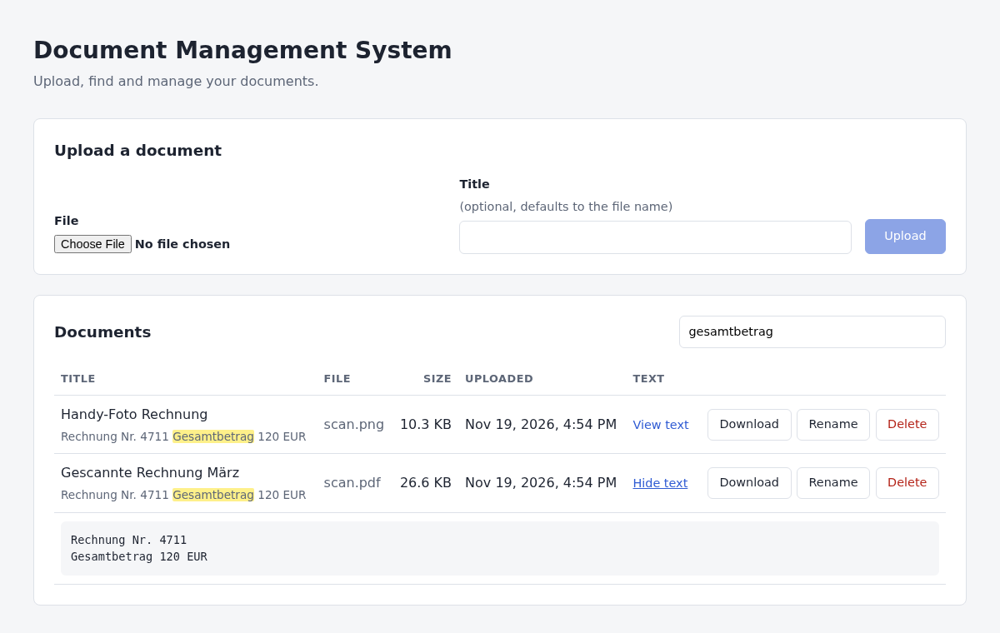
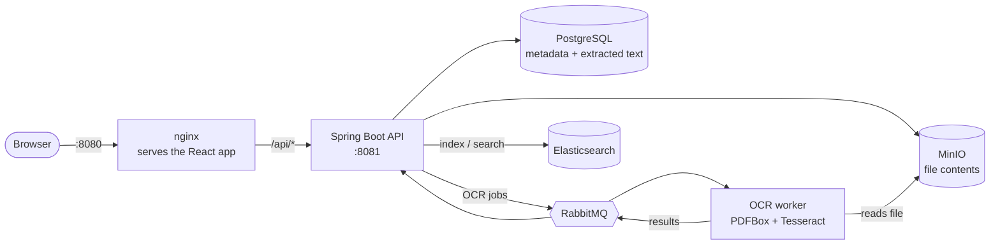

# Document Management System

[](https://github.com/JohannesHenz/document-management-system/actions/workflows/ci.yml)

A full-stack document management system with OCR and full-text search. Uploaded PDFs and images are
stored in object storage, their text is extracted by a separate OCR worker over RabbitMQ, and everything
becomes searchable in Elasticsearch, including scans that contain no text layer. The whole stack starts
with a single `docker compose up`.



## Features

- Upload files up to 20 MB, with an optional title that defaults to the file name
- **Text extraction** from PDFs and images: digital PDFs are read directly, scans and photos go through
  Tesseract OCR (English and German)
- **Full-text search as you type** across titles, file names and extracted text, tolerant of typos and OCR
  errors, with the matching passage shown and highlighted
- View the extracted text of any document; extraction status updates live in the UI
- Download files under their original name, including non-ASCII names such as `Rechnung März.pdf`
- Rename and delete documents
- Errors returned as structured [RFC 9457](https://www.rfc-editor.org/rfc/rfc9457) problem responses and shown in the UI

## Tech stack

| Area       | Technologies                                                                          |
|------------|---------------------------------------------------------------------------------------|
| Backend    | Java 21, Spring Boot 3.5 (Web, Data JPA, AMQP, Validation, Actuator), Flyway          |
| OCR worker | Spring Boot, Apache PDFBox, Tesseract                                                 |
| Frontend   | React 19, Vite, Vitest, Testing Library                                               |
| Data       | PostgreSQL 17, MinIO (S3-compatible object storage), Elasticsearch 8                  |
| Messaging  | RabbitMQ 4                                                                            |
| Testing    | JUnit 5, MockMvc, H2, Testcontainers (RabbitMQ, MinIO, Elasticsearch)                 |
| Ops        | Docker multi-stage builds, Docker Compose, nginx, GitHub Actions                      |

## Architecture



1. An upload stores the file in MinIO and its metadata in PostgreSQL with text status `PENDING`.
2. Once that transaction commits, the API publishes an OCR job to RabbitMQ.
3. The worker downloads the file, extracts the text and publishes the result.
4. The API stores the text, marks the document `COMPLETED` (or `FAILED`) and indexes it in Elasticsearch.

Design decisions:

- **PostgreSQL is the source of truth.** Elasticsearch only holds a derived index: changes are indexed after
  they commit, and a missing index is rebuilt from the database on startup.
- **Messages are sent after commit.** Jobs are published from a `@TransactionalEventListener`, so the worker
  never receives a document that a rolled-back transaction never created.
- **Every job gets an answer.** Files the worker cannot read produce a failure result, so a document never
  stays pending; messages that cannot even be parsed go to a dead-letter queue instead of being retried forever.
- **OCR only where needed.** A PDF with a text layer is read directly, which is exact and fast; only scans and
  images are rendered and run through Tesseract.
- **Typed JSON messages.** Both services declare the same message records and queue topology; messages are
  matched by shape, not by Java class name.
- **Search tolerates OCR errors.** Queries combine prefix matching, for results while typing, with fuzzy
  matching, so `Gesamtbetrg` still finds `Gesamtbetrag`.
- **Pluggable infrastructure.** Storage (filesystem or MinIO), OCR and search (Elasticsearch or SQL) are
  switched by configuration, so the API also runs on its own with no external services.
- **Files are stored under random UUIDs, not their uploaded names**, and failed uploads do not leave orphaned files.
- **Flyway owns the schema.** Hibernate only validates the entities against it (`ddl-auto=validate`).

## Running it

### With Docker (recommended)

Requires Docker with Compose v2 and about 2 GB of free memory for Elasticsearch.

```bash
docker compose up --build
```

| URL                        | What                                          |
|----------------------------|-----------------------------------------------|
| <http://localhost:8080>    | Web UI                                        |
| <http://localhost:8081>    | REST API                                      |
| <http://localhost:9001>    | MinIO console (`dms` / `dms-secret`)          |
| <http://localhost:15672>   | RabbitMQ management UI (`dms` / `dms`)        |

Data persists in Docker volumes; `docker compose down --volumes` resets it. Credentials are development
defaults and can be overridden in a `.env` file (`POSTGRES_PASSWORD`, `MINIO_ROOT_USER`,
`MINIO_ROOT_PASSWORD`, `RABBITMQ_USER`, `RABBITMQ_PASSWORD`).

MinIO no longer publishes community Docker images, so the stack uses
[`pgsty/minio`](https://hub.docker.com/r/pgsty/minio), a community-maintained build of the same server.

### Locally, for development

Requires JDK 21 and Node.js 20.19 or newer. Without further configuration the API uses an in-memory H2
database, stores files on disk, searches with SQL and does not extract text.

```bash
# Terminal 1: API on :8081
cd backend
./mvnw spring-boot:run

# Terminal 2: UI on http://localhost:5173 with hot reload, proxying /api to :8081
cd frontend
npm install
npm run dev
```

To develop against the full pipeline, start the infrastructure with
`docker compose up db minio rabbitmq elasticsearch ocr-worker` and set the variables listed under
[Configuration](#configuration).

## Tests

```bash
cd backend && ./mvnw verify      # API tests with MockMvc and H2; RabbitMQ, MinIO and Elasticsearch via Testcontainers
cd ocr-worker && ./mvnw verify   # text extraction, a RabbitMQ + MinIO round trip, and real Tesseract runs if installed
cd frontend && npm test          # component tests with Vitest and Testing Library
```

The backend and worker tests need Docker for Testcontainers. CI runs all three suites on every push, then
starts the whole stack with Docker Compose and checks through the nginx proxy that a scanned invoice is
OCR'd and found by its content.

## API

| Method   | Path                          | Description                                                                      |
|----------|-------------------------------|----------------------------------------------------------------------------------|
| `POST`   | `/api/documents`              | Upload (`multipart/form-data`: `file`, optional `title`) → `201` with `Location` |
| `GET`    | `/api/documents?q=`           | List all documents, newest first, or search titles, file names and extracted text |
| `GET`    | `/api/documents/{id}`         | Document metadata, including `textStatus`                                        |
| `GET`    | `/api/documents/{id}/text`    | Extracted text as `text/plain`; `409` until extraction has completed              |
| `GET`    | `/api/documents/{id}/content` | Download the file                                                                |
| `PATCH`  | `/api/documents/{id}`         | Rename: `{"title": "..."}`                                                       |
| `DELETE` | `/api/documents/{id}`         | Delete the document, its file and its index entry → `204`                        |
| `GET`    | `/actuator/health`            | Health check                                                                     |

`textStatus` is one of `PENDING`, `COMPLETED`, `FAILED` or `NOT_EXTRACTED` (OCR disabled or unsupported file
type). Search results also carry a `snippet` with the matching passage of the extracted text.

```bash
curl -F file=@invoice.pdf -F title="March invoice" http://localhost:8081/api/documents
curl "http://localhost:8081/api/documents?q=invoice"
```

## Configuration

Spring Boot maps environment variables to properties, e.g. `DMS_OCR_ENABLED` to `dms.ocr.enabled`.

| Property                                   | Default                 | Purpose                                         |
|--------------------------------------------|-------------------------|-------------------------------------------------|
| `dms.storage.type`                         | `filesystem`            | `filesystem` or `minio`                         |
| `dms.storage.location`                     | `./data/documents`      | Directory for the filesystem storage            |
| `dms.storage.minio.endpoint` / `.bucket`   | `http://localhost:9000` / `documents` | Object storage (also `.access-key`, `.secret-key`) |
| `dms.ocr.enabled`                          | `false`                 | Send uploads to the OCR worker via RabbitMQ     |
| `dms.ocr.content-types`                    | PDF, PNG, JPEG, TIFF    | File types that are sent for extraction         |
| `dms.search.elasticsearch.enabled`         | `false`                 | Search with Elasticsearch instead of SQL        |
| `spring.rabbitmq.*`, `spring.elasticsearch.uris` | Spring Boot defaults | Connections to RabbitMQ and Elasticsearch  |

The worker reads the same `dms.storage.minio.*` and `spring.rabbitmq.*` settings, plus `dms.ocr.languages`
(`eng+deu`), `dms.ocr.dpi` (`300`) and `dms.ocr.max-pages` (`50`).

## Project history

This project started in autumn 2024 as a three-person team project in the *Software Engineering 3* course
at FH Technikum Wien. On this branch I set up the initial Spring Boot skeleton, the Dockerfiles and the
nginx/React Docker Compose setup for the first sprint. My teammates' later sprint work lives on their own
branches (`prod_Direncan`, `prod_Christian`) and is not part of this version.

In 2026 I reworked the project into the standalone application described here: I implemented the
document features end to end, added persistence with PostgreSQL and Flyway, wrote the test suites, moved
the frontend from Create React App to Vite and set up CI. I then added the OCR pipeline, object storage and
full-text search. These follow the architecture of our team's later course version of the project
([krunschy/DMS](https://github.com/krunschy/DMS)), where a teammate built the first version of the OCR
worker with RabbitMQ, MinIO and Elasticsearch; I reimplemented them from scratch on this codebase.
